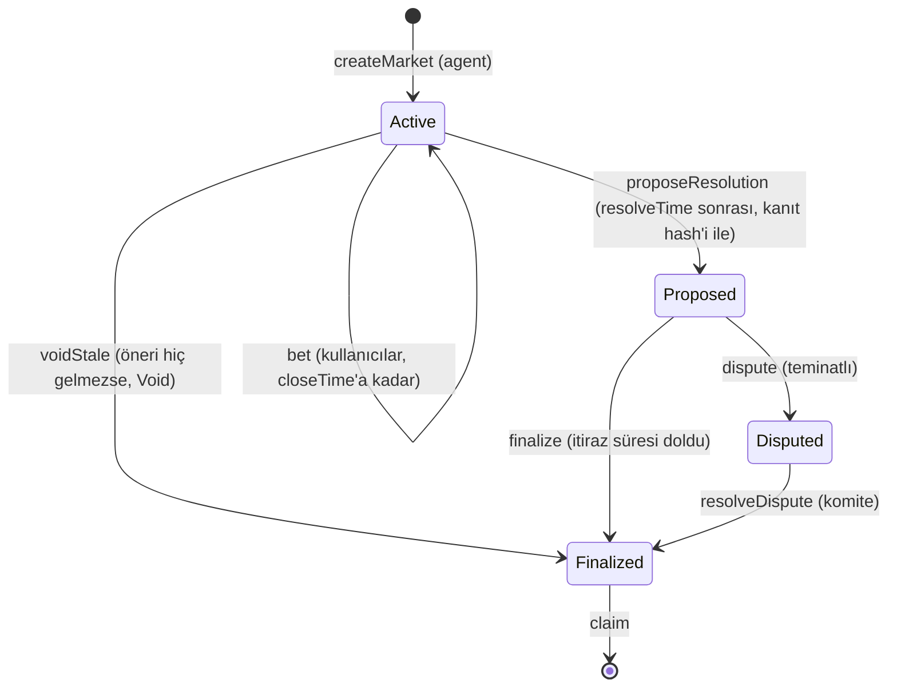
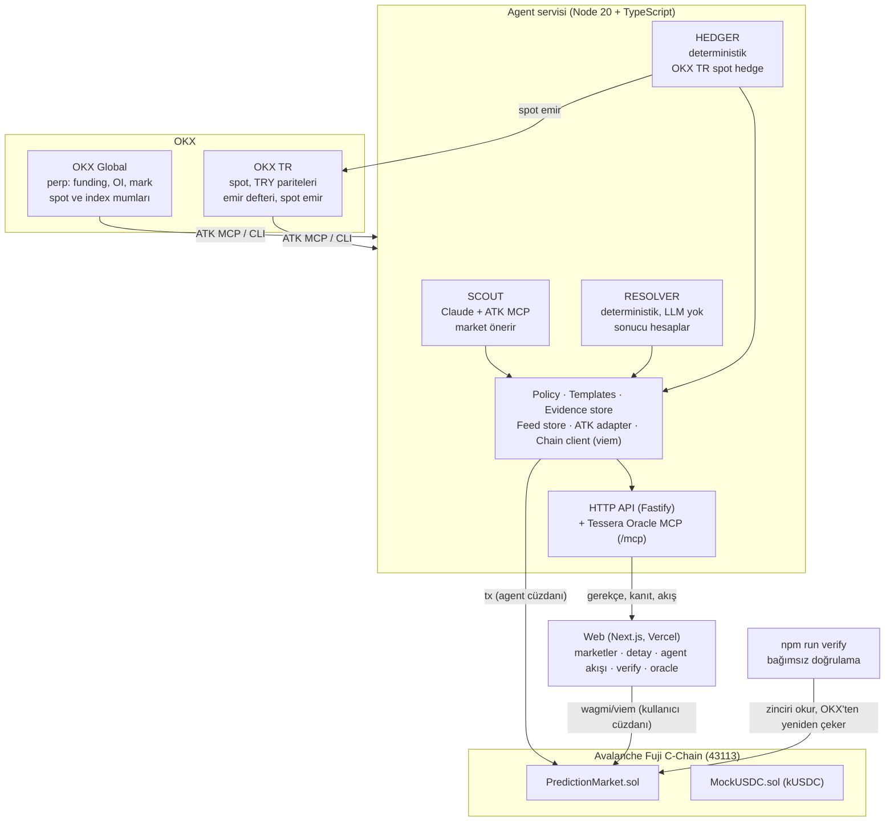

<div align="center">

# Tessera

**Agent yönetimli, kanıtlı kripto olasılık piyasası**

Bir AI agent, OKX Agent Trade Kit ile piyasayı okur, kısa vadeli tahmin marketlerini kendisi açar, süre dolunca sonucu deterministik kodla çözer ve çözümün kanıtını Avalanche'a yazar. Herkes aynı sonucu OKX'in geçmiş verisiyle yeniden hesaplayıp doğrulayabilir.

*Bize güvenmeyin, kontrol edin.*

`OKX Agent Trade Kit` · `Avalanche Fuji C-Chain` · `Claude` · `MCP` · `Solidity` · `Next.js`

OKX TR × Team1 Türkiye Agentic Hackathon · 17 Ekim 2026, Ankara

</div>

---

> ⚠️ **Testnet projesi.** Tessera bugün Avalanche Fuji testnet'inde, değeri olmayan bir test token'ı (kUSDC) ile çalışır. Gerçek para yoktur. Tessera bir bahis ürünü değil, bir olasılık (tahmin) piyasasıdır ve yatırım tavsiyesi vermez.

## İçindekiler

- [Problem](#problem)
- [Çözüm](#çözüm)
- [Nasıl çalışır](#nasıl-çalışır)
- [Mimari](#mimari)
- [Soru şablonları](#soru-şablonları)
- [Akıllı kontratlar](#akıllı-kontratlar)
- [Agent servisi](#agent-servisi)
- [Kanıt ve bağımsız doğrulama](#kanıt-ve-bağımsız-doğrulama)
- [Tessera Oracle (MCP servisi)](#tessera-oracle-mcp-servisi)
- [Web arayüzü](#web-arayüzü)
- [Güvenlik modeli](#güvenlik-modeli)
- [Neden Avalanche?](#neden-avalanche)
- [Kurulum](#kurulum)
- [Deploy edilen kontratlar](#deploy-edilen-kontratlar)
- [Repo yapısı](#repo-yapısı)
- [İş modeli ve yol haritası](#iş-modeli-ve-yol-haritası)

## Problem

1. **Oracle bir kara kutu.** Tahmin piyasalarının en zayıf halkası sonucu belirleyen süreçtir. Popüler platformlarda sonuç çoğu zaman insan oylamasıyla belirlenir ve kullanıcı "sonuç doğru mu?" sorusunu kendisi kontrol edemez.
2. **Perp verisi görünmüyor.** OKX TR'de yalnız spot piyasa var. Oysa kısa vadeli fiyatı funding rate ve open interest gibi türev verileri hareket ettiriyor.
3. **Market açmak emek ister.** İlginç ve zamanında soru bulmak, eşik ve süre seçmek, takip edip çözmek sürekli dikkat gerektirir. Bu tam bir agent işi.

## Çözüm

| | Ne yapar | Nasıl |
|---|---|---|
| **Agent market açar** | Global perp ve TR spot verisini tarar, ilginç bir durumda market önerir | Claude + ATK MCP, yalnız kayıtlı şablonlardan, Türkçe gerekçeyle |
| **Agent marketi çözer** | Süre dolunca sonucu hesaplar ve kanıtını zincire yazar | **LLM'siz**, deterministik kod, yalnız geçmişte tekrar çekilebilen veri |
| **Herkes doğrular** | Aynı veriyi OKX'ten çekip aynı sonucu ve aynı hash'i üretir | `npm run verify -- <marketId>` |
| **İtiraz edilebilir** | Sonuç önerildikten sonra itiraz süresi başlar | Teminatlı `dispute`, itiraz yoksa sonuç kesinleşir |
| **Agent riskini dengeler** | Başlangıç likiditesinden doğan yönsel riski azaltır | OKX TR'de tavanlı küçük spot işlemler |

> **LLM soruyu sorar, kod sonucu okur.** Sonucu bir dil modelinin yorumuna bırakmak oracle'ı halüsinasyona ve prompt manipülasyonuna açar. Bu yüzden çözüm tarafında LLM yoktur.

Perp verisi yalnız **soru** olarak kullanılır. Tessera bir perp ürünü değildir; kaldıraç ve likidasyon yoktur.

## Nasıl çalışır

**Kullanıcı açısından:**

1. Siteye gir, Core veya MetaMask cüzdanını bağla (gerekirse "Fuji'ye geç").
2. Faucet'ten test kUSDC al (adres başına saatte 1000 kUSDC).
3. Açık bir markete gir: soru, kurallar, kalan süre, YES/NO havuzları, ima edilen olasılık ve agent'ın kendi tahmini görünür.
4. YES veya NO seç, tutarı gir ve onayla.
5. Süre dolunca agent sonucu önerir ve kanıt kartı görünür. 5 dakikalık itiraz süresinden sonra sonuç kesinleşir.
6. Kazandıysan **Claim** ile ödülünü al.

**Bir marketin yaşam döngüsü:**



## Mimari



**Doğruluk kaynağı:**

- **Zincir:** paralar, market durumu, sonuç, kanıt hash'i.
- **Agent servisi:** gerekçe metni, araç çağrı izi, ham kanıt JSON'u. Kanıtın hash'i zincirde olduğu için sonradan değiştirilemez; değiştirilirse hash tutmaz.

Agent servisi durumsuz tasarlanmıştır: yeniden başladığında her şeyi zincirden okur. Agent API'si erişilemez olsa bile web arayüzü market, havuz ve sonuçları zincirden göstermeye devam eder.

## Soru şablonları

Projenin kalbi şablonlardır. **LLM serbest soru yazamaz;** yalnız kayıtlı bir şablonu ve parametrelerini seçer. Her şablonun üç parçası vardır: parametre şeması (zod), Türkçe soru metni üretici ve deterministik `resolve` fonksiyonu. Şablon kimliği ve ABI-kodlu parametreler market açılırken zincire yazılır, yani kural sonradan değiştirilemez.

| ID | Şablon | Kural | Veri (ATK) |
|---|---|---|---|
| 1 | `PRICE_ABOVE` | `close(resolveTime) > eşik` ise YES | `market_get_candles` (1m) |
| 2 | `FUNDING_POSITIVE` | Belirli funding kaydının gerçekleşmiş oranı > 0 ise YES | `market_get_funding_rate` (history) |
| 3 | `PRICE_IN_BAND` | `low ≤ close(resolveTime) < high` ise YES (canlı ızgara) | `market_get_candles` + index |
| 4 | `OI_CHANGE` | `OI(T) / OI(T−w) − 1` eşik karşılaştırması | `market_get_oi_history` |
| 5 | `TRY_PREMIUM_ABOVE` | `BTC-TRY / (BTC-USDT × USDT-TRY) − 1 > eşik` ise YES | `market_get_candles` ×3 |

**Zaman ve sayı kuralları:**

- Tüm zamanlar Unix saniye, UTC ve dakikaya hizalıdır.
- "t anındaki fiyat", açılışı `t − 60` olan **kapanmış** (`confirm = 1`) 1 dakikalık mumun kapanış fiyatıdır.
- Çözüm `resolveTime + 90 sn` sonra yapılır ki mum kesinleşsin. Anlık ticker ile çözüm yapılmaz.
- Fiyatlar ×1e8 tam sayı, yüzdeler baz puan (bps) olarak tutulur. Karşılaştırmalar BigInt ile yapılır, float kullanılmaz.

**Çapraz kontrol:** Fiyat şablonlarında birincil mumun yanında aynı dakikanın index mumu (ör. BTC-USD) de çekilir. Fark 50 bps'i aşarsa veri şüpheli sayılır ve market **Void** (iptal, herkese iade) olarak önerilir.

### Canlı ızgara

`/grid` sayfasında BTC-USDT fiyatı canlı akar. Önünde 3 dakikalık sütunlar ve 50 $'lık fiyat bantları vardır. Her kare bir `PRICE_IN_BAND` marketidir ("BTC 15:24'te 81.550–81.600 $ aralığında kapanır mı?"). Kareye tıklamak o markette YES'e tahmin demektir. Izgara yapıcı, son 60 dakikanın oynaklığından log-normal bir modelle her bandın olasılığını hesaplar ve başlangıç likiditesini buna göre dağıtır.

## Akıllı kontratlar

Solidity ^0.8.24, Foundry ve OpenZeppelin 5 ile yazıldı.

**`MockUSDC.sol`:** "Test USD" (kUSDC), 6 decimals. `faucet()` çağırana 1000 kUSDC verir (adres başına saatte bir). Açıkça değeri olmayan bir test token'ıdır.

**`PredictionMarket.sol`:** Parimutuel (havuz tabanlı) ikili tahmin marketi.

| Rol | Fonksiyonlar |
|---|---|
| Agent | `createMarket`, `proposeResolution` |
| Kullanıcı | `bet`, `dispute`, `finalize`, `claim`, `voidStale` |
| Owner / komite | `resolveDispute`, `setAgent`, `setParams`, `pause` / `unpause` |

| Parametre | Varsayılan | Açıklama |
|---|---|---|
| `feeBps` | 100 (%1) | YES/NO ile çözülen markette toplam havuzdan ücret |
| `disputeWindow` | 300 sn | Demo için kısa; üründe saatler |
| `disputeBond` | 10 kUSDC | İtiraz teminatı |
| `minBet` | 1 kUSDC | |
| `minResolveGap` | 120 sn | Tahminlerin kapanışı ile ölçüm arasındaki en kısa süre |
| `proposeDeadline` | 2 saat | Bu sürede öneri gelmezse herkes `voidStale` çağırabilir |

**Kurallar:**

- Tek taraflı market veya kazanan tarafı boş market otomatik olarak **Void** olur ve herkes parasını geri alır.
- Ödeme: `payout = kullanıcınınPayı × (toplamHavuz − ücret) / kazananHavuz`.
- İtiraz komite tarafından karara bağlanır. Agent'ın önerisi bozulursa teminat itiraz edene iade edilir, bozulmazsa hazineye gider.
- Checks-Effects-Interactions, `ReentrancyGuard`, `SafeERC20`; sınırsız approve istenmez.

Foundry testleri mutlu yolu, Void durumlarını, zaman kısıtlarını, itiraz akışını, çift claim'i, ücret hesabını (fuzz) ve pause'u kapsar.

## Agent servisi

Node 20 ve TypeScript ile yazılmış tek bir süreç: üç döngü ve bir HTTP sunucusu.

### Scout: market açar (LLM'li)

Her 10 dakikada bir Claude'a güncel bağlam (zaman, açık marketler, izinli enstrümanlar, şablon kataloğu) ve OKX Agent Trade Kit'in **yalnız okuma** araçları verilir. Claude veriyi inceleyip ya `propose_market` çağırır ya da "şu an uygun market yok" der.

- Kullanabildiği ATK araçları (allowlist): `market_get_ticker`, `market_get_candles`, `market_get_funding_rate`, `market_get_oi_history`, `market_filter_oi_change`, `market_get_indicator`, `market_get_mark_price`, `market_get_orderbook` (global ve TR sunucuları, `global__` / `tr__` önekiyle).
- Her öneride en az iki farklı ATK aracından veri kullanır ve gerekçede sayılarla belirtir.
- Soru metni LLM'den değil şablondan üretilir, böylece soru kuralla her zaman birebir aynıdır.
- Öneri **Policy** katmanından geçer; reddedilirse sebebiyle akışa yazılır ve Claude'a bir düzeltme hakkı verilir.
- Kabul edilen market açılır ve agent kendi olasılık tahminine göre 20 kUSDC başlangıç likiditesi koyar.

### Resolver: marketi çözer (LLM yok)

Her 30 saniyede vadesi gelen marketleri bulur. Şablonun `resolve` fonksiyonu ATK CLI'yı `--json` ile çağırır (aynı komut kanıta birebir yazılır), sonucu hesaplar, kanıt JSON'unu oluşturur ve `proposeResolution` çağırır. Veri gelmezse tekrar dener; süre dolmak üzereyse `DATA_UNAVAILABLE` sebebiyle Void önerir. İtiraz süresi dolan marketleri de `finalize` eder.

### Hedger: riski dengeler (bonus)

Her 5 dakikada agent'ın BTC fiyat marketlerindeki net yönsel pozisyonunu hesaplar ve OKX TR'de küçük spot emirlerle dengeler. Emirler yalnız koddan, sabit tavanlarla verilir (ör. en fazla 20 USDT). Spot'ta açığa satış olmadığı için bu tam bir risk nötrleme değil, gösterilebilir bir risk yönetimi döngüsüdür.

### Policy (kod, LLM değil)

| Kural | Değer |
|---|---|
| İzinli enstrümanlar | BTC/ETH/AVAX-USDT, BTC/ETH-USDT-SWAP, BTC-TRY, USDT-TRY |
| Market süresi | 15 dk – 3 saat |
| Aynı anda açık market | ≤ 6 |
| Tekrar | Aynı şablon + enstrüman + ±%1 eşik yasak |
| `PRICE_ABOVE` eşiği | Anlık fiyatın ±%3'ü içinde |
| Agent'ın olasılık tahmini | 0,15 – 0,85 (çok kesin sonuçlu market açılmaz) |
| Kill switch | `PAUSE_AGENT=1` + kontratta `pause()` + `HEDGE_ENABLED=0` |

### HTTP API (Fastify, port 8787)

| Endpoint | Döner |
|---|---|
| `GET /health` | Zincir, kontrat, agent adresi, döngü durumları |
| `GET /api/feed` | Akış olayları: market açıldı, öneri reddedildi, çözüldü, hedge, hata |
| `GET /api/stream` | Yeni akış olayları (SSE) |
| `GET /api/markets/:id/meta` | Gerekçe, olasılık tahmini, araç çağrı izi |
| `GET /evidence/:id.json` | Kanıt JSON'u |
| `GET /api/stats` | Araç bazında ATK çağrı sayıları, açılan/çözülen market sayısı |

## Kanıt ve bağımsız doğrulama

Her çözümün bir kanıt JSON'u vardır. `core` kısmı tekrar üretilebilir, `meta` kısmı (çekilme zamanı, ham çıktı) değildir:

```json
{
  "core": {
    "v": 1,
    "chainId": 43113,
    "marketId": 7,
    "templateId": 1,
    "params": { "site": "global", "instId": "BTC-USDT", "thresholdE8": "10500000000000" },
    "resolveTime": 1792256400,
    "observations": [
      { "role": "primary", "kind": "candle_1m", "instId": "BTC-USDT", "close": "105231.4", "confirm": "1" },
      { "role": "crosscheck", "kind": "index_candle_1m", "instId": "BTC-USD", "close": "105198.0", "confirm": "1" }
    ],
    "crossCheck": { "maxBps": 50, "diffBps": 3, "ok": true },
    "rule": "primary.close > threshold",
    "outcome": "YES"
  },
  "meta": { "fetchedAt": "…", "commands": ["OKX_SITE=global okx market candles …"], "tx": "0x…" }
}
```

```
evidenceHash = keccak256(utf8(canonicalJSON(core)))
```

Kanonik JSON'da anahtarlar alfabetik sıralı, boşluksuz ve sayılar string'dir. Böylece aynı veri her makinede aynı hash'i verir.

**Kendin doğrula:**

```bash
cd agent
npm run verify -- 7
```

Komut zincirden market 7'nin şablonunu, parametrelerini ve hash'ini okur, aynı veriyi OKX'ten yeniden çeker, `core`'u kurup hash'ler ve zincirdekiyle karşılaştırır:

```
✅ Sonuç YES, hash eşleşiyor
```

Web'deki `/verify` sayfası da kanıt JSON'unu tarayıcıda hash'leyip zincirdekiyle karşılaştırır ("bu dosya değiştirilmemiş").

## Tessera Oracle (MCP servisi)

Resolver'ın çözüm motoru, başka agent'ların çağırabileceği bir **MCP servisi** olarak da sunulur. OKX.AI'da A2MCP servisi olarak listelenmeye hazırdır (aynı girdiye her zaman aynı çıktı, çağrı başı ücret).

| Araç | Ne yapar | Ücret (taslak) |
|---|---|---|
| `list_templates` | Şablon kataloğu ve kurallar | Ücretsiz |
| `resolve_metric` | Geçmiş bir an için kanıtlı sonuç, kanıt ve hash | 0,01 USDC |
| `get_market` | Zincirdeki market, kanıt ve doğrulama durumu | Ücretsiz |
| `get_forecast` | Agent'ın olasılık tahmini ve gerekçesi | 0,005 USDC |
| `list_open_markets` | Tahmine açık marketler ve ızgara kareleri | Ücretsiz |
| `prepare_bet` / `prepare_claim` | İmzalanmamış işlem verisi (çağıran agent kendi cüzdanıyla imzalar) | Ücretsiz |
| `get_position` | Pozisyon, alınabilir ödül, bakiye | Ücretsiz |

Servis yalnız okur; zincire yazmaz, emir vermez ve anahtar tutmaz. Başka agent'lar Oracle MCP ve kısıtlı bir cüzdan MCP'si (`npm run wallet:stdio`) ile Tessera marketlerine katılabilir. Örnek: `npm run rival`.

> Bugün çalışan bir MCP sunucusu ve listeleme kartı (`docs/OKXAI_LISTING.md`) var. OKX.AI'a gerçek kayıt ve x402 tahsilatı henüz yapılmadı.

## Web arayüzü

Next.js (App Router), TypeScript, Tailwind, wagmi v2 ve viem. Mobil öncelikli.

| Sayfa | İçerik |
|---|---|
| `/` | Açık, yakında çözülecek ve son çözülen marketler; canlı sayaçlar |
| `/market/[id]` | Soru, kurallar, geri sayım, havuzlar, agent tahmini, tahmin paneli, "Agent neden açtı?", kanıt kartı, claim/dispute |
| `/grid` | Canlı BTC fiyat ızgarası, tek tıkla tahmin |
| `/agent` | Agent'ın canlı akışı, ATK araç kullanımı, ortalama onay süresi |
| `/verify` | Kanıt JSON'unu tarayıcıda hash'leyip zincirle karşılaştırma |
| `/oracle` | Tessera Oracle servis kartı ve örnek çağrı |

Arayüz her işlemin "gönderildi → onaylandı" süresini ölçüp gösterir ("1,2 sn'de kesinleşti"). Tüm zamanlar kullanıcıya TR saatiyle, kanıtta UTC ile gösterilir.

## Güvenlik modeli

- **LLM'in yetkisi sınırlı.** Claude yalnız okuma amaçlı ATK araçlarını ve `propose_market` / `list_open_markets` araçlarını görür. Zincire yazamaz, emir veremez, anahtar okuyamaz. Prompt injection en kötü ihtimalle Policy'nin reddedeceği bir öneri üretir.
- **Yazma işlemleri yalnız koddan.** Zincir işlemleri ve spot emirler deterministik koddan, sabit tavanlarla gider.
- **Anahtarlar ayrık.** OKX TR API anahtarı yalnız ATK CLI'da, yalnız trade izniyle (para çekme izni yok). Agent'ın Fuji anahtarı `.env`'de, kontratta yalnız agent rolüne sahip. Owner anahtarı agent sürecinde yok.
- **Kill switch:** servis için `PAUSE_AGENT`, kontrat için `pause()`, hedge için `HEDGE_ENABLED=0`.

**Güven varsayımı:** Veri kaynağı OKX'tir ve çapraz kontrol aynı sağlayıcının endeksidir. Agent'ın yanlış önerisi `verify` ile tespit edilip itiraz edilebilir; itirazı bugün owner (merkezî komite) karara bağlar. Yol haritasında birden fazla bağımsız çözücü agent ve ERC-8004 Validation Registry var.

## Neden Avalanche?

- **Hızlı kesinlik:** 15 dakikalık marketler ancak işlemlerin saniyeler içinde kesinleştiği bir zincirde anlamlı. Tahmin kapanışa saniyeler kala bile güvenle girilir.
- **Düşük ücret:** Her market için ayrı kanıt hash'i, her çözüm için ayrı işlem ve agent'ın likidite işlemleri ancak ucuz bir zincirde ekonomik.
- **Custom L1 + ICM (yol haritası):** Ürün büyüdüğünde marketler kendi L1'inde çalışır, kesinleşmiş sonuçlar ICM ile diğer zincirlere yayınlanır. Tessera, Avalanche ekosistemi için çapraz-L1 bir oracle olur.
- **ERC-8004:** Agent kimliği ve sicili aynı zincirde tutulabilir.

## Kurulum

**Gereksinimler:** Node 20+, [Foundry](https://book.getfoundry.sh/), OKX Agent Trade Kit, bir Fuji cüzdanı (test AVAX ile) ve bir Anthropic API anahtarı.

```bash
# 1. Repoyu klonla (contracts altındaki submodule'lerle birlikte)
git clone --recursive https://github.com/Muhammed5500/Tessera.git
cd Tessera

# 2. OKX Agent Trade Kit
npm install -g @okx_ai/okx-trade-mcp @okx_ai/okx-trade-cli
okx --version
```

**Kontratlar:**

```bash
cd contracts
forge build
forge test
# Deploy: MockUSDC → PredictionMarket → agent'a kUSDC mint; adresler deployments/fuji.json'a yazılır
```

**Agent servisi:**

```bash
cd agent
npm install
cp .env.example .env   # FUJI_RPC_URL, AGENT_PRIVATE_KEY, ANTHROPIC_API_KEY vb.
npm run dev            # üç döngü + HTTP API (port 8787)
```

| Komut | Ne yapar |
|---|---|
| `npm run dev` | Tüm döngüleri ve sunucuyu başlatır |
| `npm run scout:once` / `resolver:once` / `hedger:once` | Tek bir döngüyü bir kez çalıştırır |
| `npm run verify -- <id>` | Bir marketin sonucunu bağımsız olarak doğrular |
| `npm run create-manual` | Elle market açar |
| `npm run oracle:stdio` / `oracle:smoke` | Tessera Oracle MCP'yi yerelde çalıştırır / test eder |
| `npm run wallet:stdio` | Dış agent'lar için kısıtlı cüzdan MCP'si |
| `npm run rival` | Örnek rakip agent |
| `npm run traders` | Demo trader agent'ları |
| `npm test` | Şablon, kanonik hash ve policy testleri (vitest) |

`DRY_RUN=1` ile agent zincire işlem göndermez, yalnız ne göndereceğini loglar.

**Web:**

```bash
cd web
npm install
# .env.local: NEXT_PUBLIC_CHAIN_ID, NEXT_PUBLIC_PM_ADDRESS, NEXT_PUBLIC_USDC_ADDRESS, NEXT_PUBLIC_AGENT_API ...
npm run dev
```

## Deploy edilen kontratlar

Avalanche Fuji C-Chain (chainId `43113`), deploy bloğu `59593527`.

| Kontrat | Adres |
|---|---|
| PredictionMarket | [`0x3Bf77E4712101E8AB41aB4622B14E5261a144336`](https://testnet.snowtrace.io/address/0x3Bf77E4712101E8AB41aB4622B14E5261a144336) |
| MockUSDC (kUSDC) | [`0xC89189F5336E41e8FE32d69D09040Ad1bf0a5Aa4`](https://testnet.snowtrace.io/address/0xC89189F5336E41e8FE32d69D09040Ad1bf0a5Aa4) |
| Agent cüzdanı | [`0x6b3882eD566e21d74Cea2341895F442100e36212`](https://testnet.snowtrace.io/address/0x6b3882eD566e21d74Cea2341895F442100e36212) |
| Owner / Treasury | [`0x3566Dd8977Fa03AC22c47bb6E69100f569f00272`](https://testnet.snowtrace.io/address/0x3566Dd8977Fa03AC22c47bb6E69100f569f00272) |

## Repo yapısı

```
Tessera/
├─ README.md
├─ CLAUDE.md              # Claude Code için proje kuralları
├─ docs/
│  ├─ MIMARI.md           # ayrıntılı mimari doküman
│  ├─ PLAN.md             # uygulama planı
│  └─ OKXAI_LISTING.md    # OKX.AI A2MCP listeleme kartı
├─ deployments/fuji.json  # kontrat adresleri
├─ contracts/             # Foundry: PredictionMarket.sol, MockUSDC.sol, testler, deploy script
├─ agent/
│  ├─ src/
│  │  ├─ atk/             # ATK MCP istemcisi + CLI sarmalayıcı + sayaç
│  │  ├─ chain/           # viem client, ABI, event izleme
│  │  ├─ templates/       # şablonlar: şema + soru metni + resolve
│  │  ├─ evidence/        # kanonik JSON, kanıt oluşturma ve saklama
│  │  ├─ policy/          # Scout önerileri için kurallar
│  │  ├─ scout/           # LLM döngüsü, sistem promptu, araçlar
│  │  ├─ resolver/        # deterministik çözüm döngüsü
│  │  ├─ hedger/          # OKX TR spot hedge
│  │  ├─ grid/            # canlı ızgara yapıcı
│  │  ├─ oracle-mcp/      # Tessera Oracle MCP sunucusu
│  │  ├─ feed/            # olay akışı deposu
│  │  └─ server/          # Fastify HTTP API
│  ├─ scripts/            # verify, *-once, create-manual, rival, traders…
│  └─ test/               # vitest
├─ web/                   # Next.js arayüz
└─ scripts/
```

| Katman | Teknoloji |
|---|---|
| Kontrat | Solidity ^0.8.24, Foundry, OpenZeppelin 5 |
| Agent | Node 20, TypeScript, viem, @anthropic-ai/sdk, @modelcontextprotocol/sdk, zod, Fastify, vitest |
| Web | Next.js, Tailwind, wagmi v2, viem |
| Altyapı | Avalanche Fuji, Vercel, Cloudflare tunnel |

## İş modeli ve yol haritası

**Hedef kullanıcılar:**

- **Tahminciler (B2C):** Kısa vadeli piyasa görüşünü kaldıraç kullanmadan test etmek isteyen OKX TR kullanıcıları ve üniversite kripto kulüpleri.
- **Oracle tüketicileri (B2B ve agent'lar):** "Şu metrik şu zamanda şu eşiğin üstünde miydi?" sorusunun kanıtlı cevabına ihtiyaç duyan diğer tahmin piyasaları ve trading agent'ları.

**Gelir:** Çözülen marketlerde %1 havuz ücreti, OKX.AI üzerinden çağrı başı oracle ücreti ve kendi ligini isteyen borsa ve topluluklar için beyaz etiket.

**İlk 90 gün:**

| Dönem | Adım |
|---|---|
| Hafta 1–4 | Puan tabanlı tahmin ligi (testnet): Team1 Türkiye üniversite ağı ve OKX TR topluluğu |
| Ay 2 | Tessera Oracle'ın OKX.AI'da A2MCP servisi olarak listelenmesi |
| Ay 3 | C-Chain mainnet, hukuki görüşe bağlı olarak lisanslı yapı veya yalnız B2B oracle |

**Sonrası:** Mühürlü (gizli yönlü) tahmin modu, ikiden fazla seçenekli marketler, birden fazla bağımsız çözücü agent, Tessera L1 + ICM.

**Bilinçli olarak kapsam dışı:** perp/kaldıraç, AMM fiyatlama (parimutuel yeterli), kripto dışı olaylar, haber/sentiment tabanlı marketler, gerçek para ve KYC.

---

<div align="center">

OKX TR × Team1 Türkiye Agentic Hackathon için geliştirildi.

</div>
